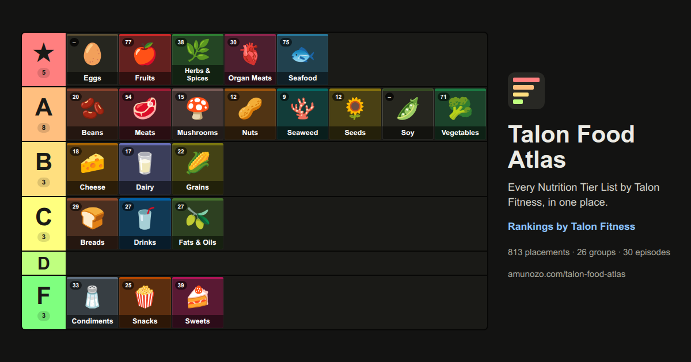

# Talon Food Atlas

An unofficial, fan-made interactive atlas of the **Nutrition Tier Lists** by [Talon Fitness](https://www.youtube.com/@Talon_Fitness). The rankings and the analysis are all his; this just puts every episode in one place.

**Live:** https://www.amunozo.com/talon-food-atlas/



- 813 placements from 30 episodes, plus Talon's ranking of the food groups.
- Every food links to the moment it appears in its episode.
- Each food has a short AI-written summary of Talon's reasoning (from the episode captions) and its on-screen nutrition card (read by AI from the video). Both were spot-checked; see `notes/audit-why-and-tiers.md`.

Spotted a mistake? [Open an issue](https://github.com/amunozo/talon-food-atlas/issues).

## Build

```sh
python3 build.py                      # data.json + index.html from the CSV, template and pipeline outputs
python3 -m pytest -q test_build_data.py
```

- `talon-food-atlas-rankings.csv`: source placements; fixes are applied as override tables in `build_data.py`.
- `template.html`: the page (vanilla HTML/CSS/JS); `index.html` is generated.
- `pipeline/`: scripts that fetch captions, extract nutrition cards (Gemini via OpenRouter) and write reasons. Raw captions and transcripts are not included.
- `notes/`: spec, audit, model pilots and costs.

Built with AI coding agents (Claude Code).
